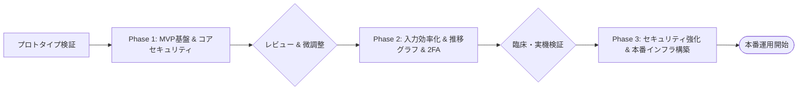
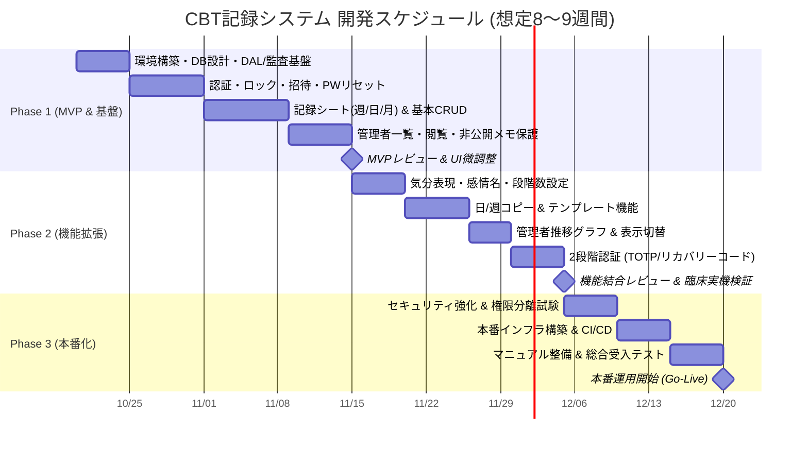

# CBT記録システム 開発計画書 (Development Plan)

- **文書バージョン**: 1.3.0
- **改定日**: 2026-10-21
- **対象システム**: CBT（認知行動療法）週間活動記録システム
- **関連文書**:
  - `docs/requirements_specification.md`
  - `docs/system_specification.md`
  - `prototype/index.html`

---

## 1. プロジェクト方針と開発アプローチ

### 1.1 開発方針
本プロジェクトは、**「今後UIや細部仕様の微調整が発生する」** ことを前提とし、小さく動くものを素早く検証・改善できる**イテレーティブ（反復型・アジャイル）開発**を採用します。
プロトタイプ（HTMLモック）で合意した操作感・UI構造を土台とし、**セキュリティ境界（アクセス分離・非公開メモ保護）を最初から組み込んだMVP（実用最小限の製品）** をPhase 1で立ち上げ、実際の入力フィードバックを得ながら完成度を高めていきます。

### 1.2 成功要件
1. **ユーザビリティ最優先**: スマホ・PC双方で「毎日の記録が苦にならない」スムーズなUXの実現。
2. **要配慮個人情報の防衛**: メンタルヘルスデータに相応しい堅牢な認証・認可（DALによる強制分離）・暗号化の担保。
3. **仕様変更への柔軟性**: コンポーネント指向設計（React/Next.js）と正規化されたデータ構造により、気分設定や入力項目の拡張に強いアーキテクチャを維持。

---

## 2. 開発フェーズとマイルストーン

| フェーズ | 期間目安 | 主な目標・ゴール | 主な成果物 |
| :--- | :---: | :--- | :--- |
| **Phase 1: MVP基盤 & コアセキュリティ開発** | 3〜4週間 | ・DBスキーマ、DAL（アクセス分離）、監査ログ基盤の構築 ・認証基盤（ログイン、ロックアウト、招待〜本登録、PWリセット） ・週間活動記録（週/日/月表示）のCRUDと気分設定基本連携 ・管理者による担当メンバー一覧・シート閲覧・**非公開メモ（秘匿ガード込み）** | 動作可能なコアWebアプリ、Prismaスキーマ、基本API群 |
| **Phase 2: 入力効率化 & 支援強化・2FA** | 2〜3週間 | ・過去日/週の丸ごとコピー機能（空枠のみ/気分コピー選択対応） ・生活パターン別テンプレート作成・一括適用機能 ・気分表現カスタマイズの完全実装（感情名・5種スタイル・3〜11段階） ・管理者画面の気分推移グラフ・アーカイブ整理、2FA (TOTP + リカバリーコード) | 入力支援機能一式、推移グラフ、MFA認証 |
| **Phase 3: セキュリティ強化 & 本番化・受入試験** | 2週間 | ・セキュリティヘッダー（CSP, HSTS, `Cache-Control: no-store`）、レートリミット強化、権限分離テスト ・本番インフラ構築（Cloud Run / Cloud SQL または 閉域自ホスト） ・バックアップ/リストア演習および運用マニュアル整備 | 本番環境、CI/CDパイプライン、バックアップ自動化、運用手順書 |
| **Phase 4: 運用開始 & 微調整・機能拡張** | 継続 | ・実運用フィードバックに基づくUI/操作性の微調整 ・PWA対応拡張（セキュアなオフライン制御） | 改善パッチ、アップデート版 |

---

## 3. 作成する開発ドキュメント一覧（ドキュメンテーション体系）

本システムは機微なメンタルヘルスデータを扱うため、設計・セキュリティ・運用の各観点で抜け漏れのないドキュメント管理を行います。ドキュメントの形骸化を防ぐため、**リポジトリ内のMarkdown形式でコードと同等にバージョン管理**します。

### 3.1 開発ドキュメント一覧マトリクス

| No | ドキュメント名 | 主な記載内容・目的 | 作成/改定時期 | 主担当 | 格納場所 / 形式 |
| :---: | :--- | :--- | :---: | :---: | :--- |
| **D-01** | **要件定義書** *(作成済)* | システム背景、ユースケース、業務フロー、機能/非機能要件、ホスティング選定比較 | 企画・要件定義期 | PM / BA | `docs/requirements_specification.md` |
| **D-02** | **システム仕様書** *(作成済)* | 基本設計、画面遷移、ER図、テーブル定義、API仕様、セキュリティ詳細仕様 | 基本設計期 | SE / Arch | `docs/system_specification.md` |
| **D-03** | **開発計画書** *(本作)* | 開発方針、WBS、工程スケジュール、テスト計画、微調整対応方針、成果物体系 | 計画策定時 | PM | `docs/development_plan.md` |
| **D-04** | **UI/UXモックアップ仕様** *(作成済)* | 週間マトリクス、スマホタイムライン、気分ピッカー、管理者画面の動的プレビュー | 要件〜設計期 | UI/UX / FE | `prototype/index.html` (HTML/Vue 3 CDN) |
| **D-05** | **データベース詳細設計書 / Schema** | Prismaスキーマ、複合ユニーク制約、インデックス設計、マイグレーション、シード定義 | Phase 1 初期 | BE | `prisma/schema.prisma` `docs/database_design.md` |
| **D-06** | **API仕様書 (OpenAPI / Swagger)** | 各エンドポイントのリクエスト・レスポンススキーマ、ステータスコード、型定義 | Phase 1〜2 | BE | `docs/openapi.yaml` |
| **D-07** | **セキュリティ設計・チェックシート** | 要配慮個人情報保護対策、暗号化鍵管理、RBAC/DALマトリクス、OWASP Top 10対策状況 | Phase 2〜3 | Sec / Arch | `docs/security_checklist.md` |
| **D-08** | **インフラ・デプロイ設計書 (IaC)** | ネットワーク構成図、Cloud Run/Cloud SQL設定、Terraform/Compose定義、Secret管理 | Phase 3 | SRE / DevOps | `infra/README.md` `docs/infrastructure_design.md` |
| **D-09** | **テスト計画書 & テスト仕様書** | 単体/結合/E2Eテスト観点、権限分離テストケース、クロスブラウザ・実機検証項目 | Phase 1〜3 | QA / Dev | `docs/test_specification.md` |
| **D-10** | **テスト結果報告書** | 各マイルストーンでの試験実施結果、不具合消化状況、受入判定結果 | 各マイルストーン | QA / PM | `docs/test_report_phase[N].md` |
| **D-11** | **システム運用・保守手順書** | 日次バックアップ/リストア手順、障害時切り分けフロー、ログ監視・アラート設定 | Phase 3 | SRE / 運用 | `docs/operations_manual.md` |
| **D-12** | **管理者（サポーター）操作マニュアル** | メンバー仮登録手順、シート確認方法、非公開メモ活用法、表示/非表示整理法 | Phase 3 | PM / 臨床担当 | `docs/manual_admin.md` |
| **D-13** | **メンバー（利用者）向け利用ガイド** | スマホでの基本入力手順、気分マークの設定変更、テンプレート・コピー活用法 | Phase 3 | UI/UX | `docs/user_guide.md` |

### 3.2 ドキュメント更新・変更管理（Single Source of Truth）
- **Markdown駆動管理**: 全ドキュメントをリポジトリでコードと共に管理し、Pull Requestを通じてレビュー・更新を行います。
- **仕様変更の先行同期**: 今後の微調整（項目の追加や画面変更）が発生した際は、`docs/system_specification.md` および `prototype/index.html` を先行して更新・合意してから本実装に着手することで、ドキュメントとコードの乖離を防止します。

---

## 4. WBS (作業分解構成図)

### 4.1 Phase 1: MVP基盤 & コアセキュリティ開発
- [x] **1.1 プロジェクト初期化 & DB基盤構築**
  - Next.js 14+ (App Router) + TypeScript + Tailwind CSS 環境初期化
  - Prisma ORM 導入、全テーブル（`users`, `user_profiles`, `admin_member_relations`, `mood_configurations`, `cbt_activities`, `activity_templates`, `audit_logs`）のスキーマ定義とマイグレーション
  - `server-only` を用いた Data Access Layer (DAL)、UTC日付変換ヘルパー、および監査ログ記録モジュールの実装
- [x] **1.2 認証・アカウント管理**
  - セッション認証実装、パスワードハッシュ化（Argon2id）および連続ログイン失敗時のアカウントロックアウト実装
  - **管理者によるメンバー仮登録・招待（`InviteModal.tsx` / `/api/admin/members/invite`）およびワンタイムURL経由の初回パスワード設定（`LoginScreen.tsx` / `/api/auth/setup-password`）**
  - 2FAコード検証ステップ、ログアウト時のセッション消去
- [x] **1.3 CBT記録シート (基本CRUD & 週/日/月ビュー)**
  - 週間活動記録マトリクスUI（PC向け週表示 `SCR-101`: 24時間×7日間、月曜始まり固定）
  - 日別タイムラインUI（モバイル向け日表示 `SCR-102`）
  - 月間カレンダー・ヒートマップUI（月表示 `SCR-103`: 記録有無・日別平均気分表示）
  - スロット個別入力モーダル（`SCR-104`: 活動名・気分選択・未記録 `null` 対応・メモ保存API）
  - 複数時間・睡眠一括入力API（`POST /api/cbt/activities/range`）
- [x] **1.4 管理者コア機能 & 非公開メモ秘匿ガード**
  - 担当メンバー一覧取得API & 表示画面（`SCR-201`）
  - 担当メンバーの週間シート閲覧機能（`SCR-202`）
  - **管理者専用支援メモ（`SCR-203`）のCRUD実装およびメンバー向けレスポンスからの `admin_memo` 完全除外テスト**

### 4.2 Phase 2: 入力効率化 & 支援強化・2FA
- [x] **2.1 気分表現カスタマイズ機能 (`SCR-107`)**
  - 対象感情名（`emotion_label`: 気分の良さ、楽しみ度、達成感等）の設定機能
  - 5種スタイル（天気・顔・パワプロ・調子矢印・数値）レンダラー実装
  - 3〜11段階スケール変換ロジック
- [x] **2.2 入力効率化 (コピー & テンプレート)**
  - 過去日の丸ごとコピー機能（`SCR-105`: 空枠のみ反映/上書き、活動のみ/気分込みオプション対応）
  - 過去週の丸ごとコピー機能（一括反映）
  - 定型ルーティン（平日出勤、在宅勤務、休日リフレッシュ、療養等）およびカスタムテンプレートの保存・一括適用機能（`SCR-106`: 活動予定のみ反映）
- [x] **2.3 管理者伴走強化機能**
  - **担当メンバーの表示/非表示（アーカイブ）トグル（`AdminView.tsx` Eye/EyeOffボタン & `/api/admin/members/[id]/visibility` PATCH/PUT）および支援ステータス（進行中/休止/完了）変更機能**
  - メンバー詳細画面（`SCR-202`）における日別平均気分推移グラフ表示機能
- [x] **2.4 2段階認証 (MFA / `SCR-003`)**
  - RFC 6238 TOTP検証ステップ組み込み（同一タイムステップのリプレイ攻撃防止）
  - 暗号化されたバックアップ・リカバリーコード発行・検証機能（単一使用で使い捨て）
- [x] **2.5 ドキュメント整備 (Phase 2)**
  - `docs/security_checklist.md` および `docs/test_specification.md` 作成
  - `docs/database_design.md` および `docs/openapi.yaml` 作成

### 4.3 Phase 3: セキュリティ強化・本番化
- [x] **3.1 セキュリティ・非機能強化**
  - IP/アカウント単位のスライディングウィンドウ・レート制限実装 (`src/lib/rate-limit.ts`)
  - CSP / HSTS / `Cache-Control: no-store` / `X-Frame-Options: DENY` / `X-Content-Type-Options: nosniff` ヘッダーの全体適用 (`next.config.mjs`)
  - 端末へのファイル持ち出し・ダウンロード機能の完全排除（エクスポート全廃原則遵守）
  - セッション無操作タイムアウト監視（25分警告、30分自動ログアウト）の組み込み (`src/components/CbtApp.tsx`)
- [x] **3.2 インフラ構築 & 実行基盤 (Docker完全非使用)**
  - **単一サーバー・単一インスタンス前提 (Docker完全非使用・ネイティブ実行)**: 分散クラスタや外部キャッシュ（Redis等）を排除し、単一ノード上で Node.js (v24+) ネイティブ直接ビルド・起動
  - SQLite 3 (WALモード) によるローカル完結・高速ファイルDB運用およびインメモリ・レートリミッターによる自律運用維持
  - GitHub Actions による自動テスト・型チェック・ビルドパイプライン構築 (`.github/workflows/ci.yml`)
  - インフラ設計書 (`docs/infrastructure_design.md`) およびDBバックアップ/リストア手順書策定
- [x] **3.3 受入テスト & 総合ドキュメンテーション**
  - 36項目の自動テストスイート構築 (`test/run-tests.js`)、型チェック・ビルドおよび `npm test` **36/36 PASS (100% 合格)** 検証
  - テスト結果報告書 (`docs/test_report.md`) 作成
  - 運用手順書 (`docs/operations_manual.md`)、管理者マニュアル (`docs/manual_admin.md`)、利用者ガイド (`docs/user_guide.md`) 整備

---

## 5. スケジュール・ロードマップ (Mermaid)

---

## 6. 品質管理 & テスト計画

### 6.1 テスト方針
| レベル | 対象・内容 | 主な検証項目・ツール |
| :--- | :--- | :--- |
| **単体テスト** | ビジネスロジック、気分スコア正規化、UTC日付変換、暗号化 | Vitest による自動テスト |
| **統合 / APIテスト** | 認証フロー、RBAC認可ガード、IDOR遮断、`admin_memo` の秘匿性 | Vitest / Next.js Route Handler Test |
| **E2Eテスト** | スマホ・PCでの一連の操作フロー、コピー・テンプレ適用 | Playwright (レスポンシブ画面幅、タップ操作検証) |
| **セキュリティ検証** | 認可バイパス、SQLi、XSS、MFAリプレイ攻撃、キャッシュヘッダー | OWASP ZAP, 静的コード解析 |
| **実機・受入テスト** | iOS Safari、Android Chrome、PCブラウザ | 実機でのスクロール感、入力しやすさ、タップ誤作動の有無 |

### 6.2 特に重点的にテストすべきポイント
1. **管理者メモの不可視性とIDOR遮断**: メンバー権限のAPIリクエストや非担当管理者のリクエストから、いかなる方法でも `admin_memo` や他メンバーの記録が流出・改ざんされないことの自動テスト。
2. **未入力（`null`）と `0.00` の厳密な区別**: 睡眠枠や未入力枠が平均気分スコアの計算やヒートマップを歪めないことの検証。
3. **日付・タイムゾーンの境界値**: 午前0時前後や週をまたぐコピー処理、月替わりの日付ズレがないこと。

---

## 7. 要件・UI微調整への対応方針 (変更管理)

1. **モックアップ（`prototype/index.html`）での事前すり合わせ**:
   - UIの変更要望は、まずHTMLモック上で試作・視覚的に確認し、`docs/system_specification.md` と同期してから本番コード（Next.js）へ反映します。
2. **JSONB型を活用したスキーマ拡張性**:
   - 気分定義（`mood_configurations.custom_labels`）やテンプレート定義（`activity_templates.schedule_data`）をJSONB型で保持しているため、新しいマークやプリセットの追加に際してDBスキーマの大規模変更を必要としません。
3. **イテレーション単位のレビュー**:
   - 1〜2週間ごとに動く成果物を確認し、フィードバックを次のイテレーションに柔軟に取り込みます。