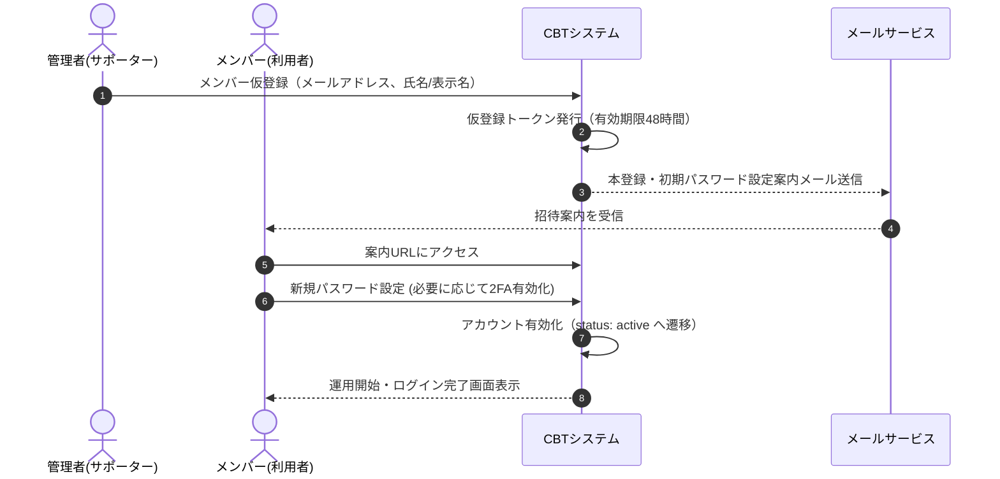
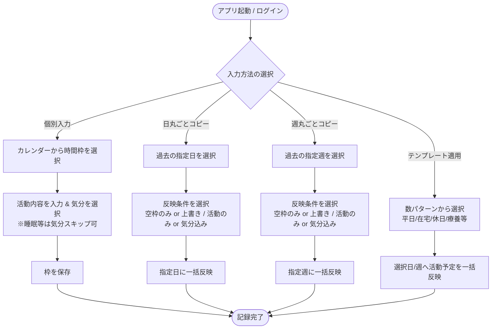
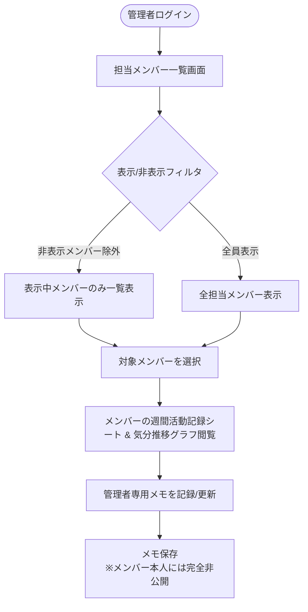

# CBT記録システム 要件定義書

- **文書バージョン**: 1.1.0
- **改定日**: 2026-10-16
- **対象システム**: CBT（認知行動療法）週間活動記録システム
- **参照元**: `docs/memo.txt`, `reference/SCBT_2_katsudokiroku.xls`, `reference/EX_SCBT_shukankatsudou.xls`

---

## 1. プロジェクト概要・背景・目的

### 1.1 背景
認知行動療法（CBT: Cognitive Behavioral Therapy）における行動活性化法（Behavioral Activation）では、クライアントが日々の活動とそれに伴う気分・感情の変化を客観的に観察・記録する「週間活動記録表」が極めて重要な役割を果たします。
従来は紙のワークシート（`reference/SCBT_2_katsudokiroku.xls` 等）や個別のExcelファイルで運用されていましたが、以下の課題が存在していました。
- **入力の煩雑さ**: 外出先やベッドの中など、リアルタイムに入力したい瞬間に紙やPCのExcelを開くハードルが高く、記録が途絶えやすい。
- **入力負荷の高さ**: 毎日・毎時間の活動を都度手作業で記述する必要があり、ルーティン活動（起床、食事、就寝など）の記録に手間がかかる。
- **カウンセラー・支援者との連携難**: カウンセリングの場に持参・郵送・ファイル送信する必要があり、タイムリーな進捗確認や助言、経過観察が行いにくい。
- **主観的気分の表現の幅**: 人によって「パーセント（0-100%）」では気分を表現しづらく、顔マークや直感的なマークを好むケースが多い。

### 1.2 システムの目的
本システムは、ブラウザからPC・タブレット・スマートフォン等のマルチデバイスで直感的に活動と気分を記録できるWebアプリケーションを提供することで、利用者の記録継続率を飛躍的に向上させ、管理者（カウンセラー・サポーター）による伴走支援を効率的かつ安全に実現することを目的とします。

### 1.3 成功の指標（KPI）
1. **継続記録率の向上**: コピー機能やテンプレート機能による1回あたりの入力所要時間を大幅削減。
2. **マルチデバイス利便性**: スマホ・PC双方での最適化UIによる離脱防止。
3. **安全な情報共有**: 医療・メンタルヘルスに関わる機微情報（要配慮個人情報）を最高水準のセキュリティで保護。

---

## 2. 利用者・ステークホルダー定義

| ロール（利用者種別） | 概要 | 想定利用環境 | 主な関心・ニーズ |
| :--- | :--- | :--- | :--- |
| **メンバー（クライアント/利用者）** | CBT記録を実際に行う当事者。自身の生活リズム・気分変化を可視化したいユーザー。 | スマートフォン、タブレット、個人PC | ・片手で素早く入力できること<br>・自分好みの気分マークで表現できること<br>・プライバシーが守られている安心感 |
| **管理者（サポーター/カウンセラー）** | 担当メンバーの活動記録を閲覧・伴走し、指導やサポートメモを残す支援者。 | PC、タブレット | ・担当メンバーの記録状況が一覧で把握できること<br>・担当別の表示/非表示整理ができること<br>・メンバーには非公開の支援メモを残せること |
| **システム管理者** | システム全体の運用、アカウント統括、セキュリティ・バックアップ管理を行う者。 | PC | ・厳格な認証・監査ログ管理<br>・サービス稼働の安定性、セキュリティ担保（※生カルテ・生記録の直接閲覧は不可） |

---

## 3. 業務フロー・ユースケース

### 3.1 メンバー登録・運用開始フロー


### 3.2 メンバーの日常入力フロー


### 3.3 管理者による伴走・モニタリングフロー


---

## 4. 機能要件一覧（FR: Functional Requirements）

### 4.1 アカウント・認証機能
| 要件ID | 要件名 | 詳細仕様 | 優先度 |
| :--- | :--- | :--- | :---: |
| **FR-AUTH-01** | メールアドレス・パスワード認証 | ・メールアドレスとパスワードによるログイン。<br>・パスワードポリシー：8文字以上、英大小文字・数字・記号混在を推奨。<br>・連続ログイン失敗によるアカウントロック（5回連続失敗で15分間ロック）。 | **高** |
| **FR-AUTH-02** | 2段階認証（MFA） | ・希望するユーザーがオプトインで有効化可能。<br>・方式：RFC 6238準拠のTOTP（Google Authenticator, 1Password等）。<br>・同一タイムステップ内のコード再利用（リプレイ攻撃）防止。<br>・紛失時に備えた8桁×10組のリカバリーコード発行・検証機能。 | **高** |
| **FR-AUTH-03** | 管理者によるメンバー仮登録 | ・管理者が担当メンバーのメールアドレス、氏名/表示名を入力して仮登録。<br>・仮登録完了時に自動で本登録案内メール（有効期限48時間）を送信。 | **高** |
| **FR-AUTH-04** | メンバー本登録・パスワード変更 | ・メンバーは案内メール記載のワンタイムURLからパスワードを設定し本登録を完了。<br>・登録完了後、直ちにCBT記録の運用が開始される。 | **高** |
| **FR-AUTH-05** | パスワードリセット | ・パスワード忘却時の再設定メール送信と有効期限付きセキュアトークン検証によるリセット。 | **高** |

### 4.2 管理者機能
| 要件ID | 要件名 | 詳細仕様 | 優先度 |
| :--- | :--- | :--- | :---: |
| **FR-ADM-01** | 担当メンバー一覧参照 | ・ログインした管理者が自身に割り当てられた担当メンバーのみを一覧表示。<br>・最新記録日、未記録日数、支援ステータス（進行中 `active` / 休止 `paused` / 完了 `completed`）の可視化。 | **高** |
| **FR-ADM-02** | 担当メンバーの表示/非表示設定 | ・メンバーごとに「一覧に表示する/非表示にする（`is_visible`）」のトグル切り替えが可能。<br>・非表示にしたメンバーもアーカイブフィルタにより検索・再表示が可能。 | **高** |
| **FR-ADM-03** | 管理者メモ機能 | ・担当メンバーごとに管理者専用の自由記述メモ（経過記録・支援計画・気づき等）を残せる。<br>・**メンバー本人には完全非公開（APIレスポンスからも構造的に除外）**。<br>・最終更新日時と更新者（管理者）の自動記録。 | **高** |
| **FR-ADM-04** | メンバー記録・推移グラフ閲覧 | ・担当メンバーの週間活動記録表、カレンダー、過去の履歴を閲覧。<br>・日別・週別の平均気分スコア算出および気分の推移グラフ表示。 | **高** |

### 4.3 CBT記録シート・入力機能
| 要件ID | 要件名 | 詳細仕様 | 優先度 |
| :--- | :--- | :--- | :---: |
| **FR-CBT-01** | 週間活動記録シート表示 | ・`reference/SCBT_2_katsudokiroku.xls` を忠実に再現。<br>・各曜日について**「行動欄」と「気分欄」を独立した2列として分離配置**（原本Excelの「活動」とその右欄「％」の構造に完全準拠）。<br>・1日24時間（午前0時〜午後11〜0時の24スロット）× 7日間（月曜〜日曜始まり固定）のマトリクス表示。<br>・週送り（前週・次週・今週）ナビゲーション。<br>・入力時は行動・気分のいずれをクリックしても活動・気分・メモをまとめて登録できる統合モーダルを提供。 | **高** |
| **FR-CBT-02** | カレンダー表示切り替え | ・**週表示**（標準：週間活動記録表マトリクス）<br>・**日表示**（1日ごとの縦タイムライン形式、スマホ片手入力に最適化）<br>・**月表示**（月間カレンダー形式で記録有無や日別平均気分のヒートマップを表示し、特定日へジャンプ可能） | **高** |
| **FR-CBT-03** | スロット個別入力 | ・マス目をタップ/クリックしてモーダルまたはボトムシートで入力。<br>・入力項目：活動内容（テキスト＋クイックタグ）、気分・気持ち（選択方式、睡眠・休息時は「気分未記録（`null`）」を選択可能）、補足・気付きメモ。 | **高** |
| **FR-CBT-04** | 柔軟な「気持ち」表現・対象感情設定 | ・ユーザーの好みに応じて表現形式・段階数・記録対象の感情名を選択・カスタマイズ可能。<br>・**対象感情名（`emotion_label`）**: 「気分の良さ」「楽しみ度」「達成感」「充実度」等のポジティブ指標を設定可能。<br>・**スケール段階**: 最小3段階 〜 最大11段階（標準は5段階または11段階）。7段階以上でも各選択肢にパーセント等を併記し判別可能とすること。<br>・**表現タイプ**:<br>  1. **数値形式**（0〜100%）<br>  2. **顔マーク形式**（😄最高・🙂良好・😐普通・🙁不調・😭最悪）<br>  3. **調子矢印形式**（⬆️大幅良・↗️やや良・➡️平行/普通・↘️やや悪・⬇️大幅悪 ※その時点の調子の向きを表現）<br>  4. **パワプロ風調子マーク**（🔥絶好調・⬆️好調・➡️普通・⬇️不調・💀絶不調）<br>  5. **天気予報マーク**（☀️快晴・🌤️晴れ・☁️曇り・🌧️雨・⛈️荒天）<br>・内部データは共通の正規化値（`0.00〜1.00`、未入力時は `null`）と入力時スナップショットを保持し、表示方法を自由に切り替え可能。 | **高** |
| **FR-CBT-05** | 過去日の丸ごとコピー | ・過去の任意の1日の記録（24時間分）を選択し、指定した日付へ一括コピー。<br>・**誤上書き防止**: デフォルトは「空枠のみ反映」とし、既存入力枠を含めて上書きする場合は確認を要求。<br>・**気分コピー選択**: デフォルトは「活動内容のみコピー（気分は `null`）」とし、オプションで「気分スコアも含めてコピー」を選択可能。 | **高** |
| **FR-CBT-06** | 過去週の丸ごとコピー | ・過去の任意の1週間の記録（7日×24時間）を選択し、指定週へ一括コピー。<br>・`FR-CBT-05` と同様、「空枠のみ反映 / 上書き」および「活動内容のみ / 気分込み」の選択オプションを提供。 | **高** |
| **FR-CBT-07** | パターン別テンプレート機能 | ・よくある生活パターンを複数事前定義（「平日出勤」「在宅勤務」「休日リフレッシュ」「療養・休養」など）し、ユーザー独自のカスタムテンプレート保存も可能。<br>・指定した曜日（複数選択可）へ活動予定を一括適用。臨床データの混同を防ぐため、テンプレート適用時は活動内容のみを反映し気分スコアは未入力（`null`）とする（既存入力がある枠は「空枠のみ反映」または上書きを選択可能）。 | **高** |
| **FR-CBT-08** | **データ持ち出し防止（エクスポート全廃）** | ・最高水準の要配慮個人情報（メンタルヘルス情報）の漏洩・端末残留・持ち出しリスクを撲滅するため、**ファイルエクスポート（Excel/CSV等）機能は一切提供しない**（全閲覧・記録管理を認証下Web画面内で完結）。 | **高** |
| **FR-CBT-09** | **複数時間帯・睡眠の一括記録（範囲入力支援）** | ・「就寝」「長時間のデスクワーク」「療養」など複数時間にまたがる活動をスムーズに記録するための入力支援。<br>1. **通常モーダルの範囲指定**: 1スロット入力時に「⏱️ 複数時間をまとめて記録」をONにすることで1〜12時間の連続スロット（日跨ぎ含む）へ一括反映。「+ 就寝」クイックタグ押下時は自動で8時間・気分未入力（`null`）モードが起動。<br>2. **ワンタップ「🌙 睡眠を一括記録」**: ツールバーから対象日程（例: 木曜夜〜金曜朝）・就寝時刻・起床時刻を指定し、就寝スロットを一括登録。<br>3. **データ保護と臨床整合性**: 睡眠枠は臨床基準に従い気分スコアを未記録（`null`）とし、既存入力がある枠は「空枠のみ反映（デフォルト）」により途中覚醒や個別記録を誤上書きから保護。 | **高** |

---

## 5. 非機能要件（NFR: Non-Functional Requirements）

### 5.1 セキュリティ要件（最重要）
CBT記録は個人の心理状態や生活実態、メンタルヘルスに関する高度な機微情報（個人情報保護法上の「要配慮個人情報」に該当）を扱います。

| 項目 | 要件仕様 |
| :--- | :--- |
| **通信の暗号化** | 全通信において TLS 1.3（最低 TLS 1.2）を強制。HSTS（HTTP Strict Transport Security）有効化。 |
| **保存データの暗号化** | ・データベースボリューム全体の暗号化（AES-256）を標準適用（At-Rest Encryption）。<br>・パスワードは堅牢なハッシュ化アルゴリズム（Argon2id）を採用。<br>・2FAシークレット（`mfa_secret`）はアプリ層で鍵バージョン付き `AES-256-GCM` 暗号化を実施。<br>・バックアップファイルも暗号化して保管。 |
| **アクセス制御・認可（RBAC & データ分離）** | ・厳格な認可制御。メンバーは自己のデータのみアクセス可能。<br>・管理者は割り当てられた担当メンバーのデータのみアクセス可能（他管理者の担当データは閲覧不可）。<br>・管理者メモ（`admin_memo`）はDAL（Data Access Layer）でメンバー向けレスポンスから構造的に除外。<br>・システム管理者は業務監査ログのみ閲覧可能とし、生カルテ・生記録の直接参照を制限。 |
| **2段階認証（MFA）** | TOTP標準（RFC 6238）に準拠した認証コードを要求。ブルートフォース攻撃対策（試行回数制限、レートリミット）および同一コードのリプレイ攻撃防止を実装。 |
| **セッション・キャッシュ管理** | ・セッションIDの暗号学的乱数生成、Cookie属性（`Secure`, `HttpOnly`, `SameSite=Lax` または `Strict`）。<br>・アイドルタイムアウト（30分）および絶対タイムアウト（12時間）。長文入力中のロストを防ぐためタイムアウト前警告またはセッション延長機構を備えること。<br>・認証済みレスポンスには `Cache-Control: no-store` を強制し、CDN/ブラウザキャッシュ汚染を防止。 |
| **脆弱性対策・情報漏洩防止** | OWASP Top 10（XSS、CSRF、SQLインジェクション、SSRF等）の完全防御。CSP（Content Security Policy）ヘッダーの設定。端末ファイル持ち出し防止のためファイルダウンロード機能を一切排除。 |
| **監査ログ・追跡性** | ・ログイン、パスワード変更、メンバー情報閲覧、管理者メモ更新などの操作メタデータを改ざん不可能な形で保持（保存期間最低1年。ただし活動内容やメモ本文の平文ログ出力は禁止）。 |

### 5.2 ユーザビリティ・マルチデバイス・臨床配慮要件
| 項目 | 要件仕様 |
| :--- | :--- |
| **対応デバイス** | スマートフォン（iOS Safari / Android Chrome）、タブレット（iPad / Android）、PC（Windows / macOS）。 |
| **レスポンシブUI** | ・PC/タブレット大画面: 1週間24時間のマトリクスを一画面で俯瞰可能。<br>・スマホ縦画面: 1日ごとのタイムライン表示に最適化し、日送りボタンで前日・翌日にスムーズに移動可能。 |
| **入力操作性と端末内保護** | タップターゲットは最低44×44pxを確保。片手操作での気分入力が可能なモーダル/ボトムシートUIの提供。PWA利用時、共用端末や紛失時の情報漏洩を防ぐため、端末内ストレージ（`localStorage` / `IndexedDB`）への要配慮個人情報の平文永続化は禁止し、ログアウト時に完全消去する。 |

### 5.3 性能・可用性・拡張性
| 項目 | 要件仕様 |
| :--- | :--- |
| **応答速度** | ウォームスタート時の通常画面表示・API応答速度は95%のリクエストで 500ms 以内（ネットワーク遅延除く）。Cloud Run等のサーバーレス採用時はコールドスタート遅延を抑えるため適切な最小インスタンス設定または軽量コンテナ構成とする。 |
| **可用性（稼働率）** | 月間稼働率 99.9% 以上。24時間365日いつでも気分を記録できる状態を維持。 |
| **バックアップ** | データベースの自動日次バックアップ（リストア検証済み）。ポイントインタイムリカバリ（PITR）対応。 |

---

## 6. ホスティング環境の調査・比較・推奨選定

`docs/memo.txt` の要望に基づき、主要ホスティングサービスおよび自ホスト（公開/非公開）の比較調査を実施しました。

### 6.1 ホスティング候補の比較マトリクス

| 評価項目 | ① Google Cloud (Cloud Run + Cloud SQL) | ② Cloudflare (Pages + Workers + D1/Hyperdrive) | ③ GitHub (Pages / BaaS連携) | ④ 自ホスト：非公開 (オンプレ/自宅サーバー + VPN) | ⑤ 自ホスト：公開 (VPS + Docker) |
| :--- | :--- | :--- | :--- | :--- | :--- |
| **セキュリティ・要配慮データ適合** | **◎ 極めて高い**<br>医療情報ガイドライン・ISO27001・SOC2適合。国内リージョン（東京/大阪）完備。KMS暗号化。 | **◯ 高い**<br>Zero TrustやCloudflare Tunnelとの相性抜群。DBのリージョン固定設計に留意。 | **△ 不適**<br>GitHub Pagesは静的サイト専用。機微データを扱うバックエンドの直接ホストは不可。 | **◎ 最高（物理的分離）**<br>インターネット非公開。VPN/Tailscale経由のみアクセス。外部漏洩リスク最小。 | **△ 運用者依存**<br>OSパッチ、ファイアウォール、DDoS対策などを自前で保守する責務。脆弱性リスク大。 |
| **可用性・耐障害性** | **◎ 99.95%以上**<br>マネージド自動冗長化・自動スケール。 | **◎ 99.99%以上**<br>世界300都市以上のエッジ展開。 | **◯ 高い**<br>静的配信としては高可用。 | **△ 低〜中**<br>電源・回線障害、ハード障害時の復旧が自前対応。 | **◯ VPS依存**<br>VPS事業者のSLAに準拠。 |
| **運用保守コスト・手間** | **◯ サーバーレス**<br>OSパッチ不要。DB保守もフルマネージド。 | **◎ 運用フリー**<br>フルサーバーレス。設定が極小。 | **△ バックエンド別管理**<br>別途API/DBサーバーの保守が必要。 | **✕ 非常に高い**<br>ハードウェア・OS・ネットワーク・停電対策の保守が常時必要。 | **△ 高い**<br>Linux OS保守、Docker更新、証明書更新、監視が必須。 |
| **月額費用感** | **小〜中** (本番月$15〜$40程度) | **極小** (無料枠が手厚く月$0〜$10程度) | **極小** (静的配信のみ無料) | **初期ハード費用＋電気代** (月数千円) | **固定小** (VPS月1,000円〜3,000円) |
| **モバイル/外部からのアクセス** | **◎ スムーズ**<br>どこからでもHTTPSで快適アクセス。 | **◎ 超高速**<br>エッジCDNでスマホからも極めて低遅延。 | **◯ スムーズ** | **△ 手間あり**<br>外出先スマホからVPN接続が毎回必須。記録継続のハードルになる懸念。 | **◎ スムーズ** |

### 6.2 調査結論・推奨構成の提案

セキュリティ重要度と運用の現実性を踏まえ、以下の**2つの推奨モデル**を提案します。

```mermaid
graph TD
    subgraph パターンA: 【クラウド型・最高バランス推奨案】Google Cloud 東京リージョン
        ClientA[PC / スマホ / タブレット] -->|TLS 1.3 / HTTPS| WAF[Cloud Armor WAF]
        WAF --> AppA[Next.js App / Cloud Run]
        AppA --> DBA[(Cloud SQL for PostgreSQL / 東京リージョン)]
        DBA -.->|自動日次バックアップ| StorageA[(Cloud Storage / 暗号化)]
    end

    subgraph パターンB: 【完全閉域・自ホスト非公開推奨案】院内・内部ネットワーク専用
        ClientB[院内端末 / 許可されたスマホ] -->|WireGuard / Tailscale VPN| Gateway[VPN Gateway]
        Gateway --> HostB[自ホスト Dockerサーバー]
        HostB --> DBB[(ローカル PostgreSQL / 暗号化ボリューム)]
    end
```

#### 【推奨構成 A】Google Cloud（Cloud Run ＋ Cloud SQL 東京リージョン）
- **選定理由**:
  - 本システムが扱う「CBT記録（メンタルヘルス情報）」は日本の個人情報保護法における**要配慮個人情報**に該当します。Google Cloudの東京リージョン（`asia-northeast1`）を選択することで、データ主権（国内保管）を完全に満たせます。
  - Cloud Runはコンテナ型のサーバーレス環境のため、OSパッチやハード管理の負担が一切ありません。
  - Cloud Armor（WAF）やSecret Managerとの親和性が極めて高く、医療情報システムに求められる高水準のセキュリティを容易に構築できます。

#### 【自ホストを選択する場合の留意点】
- **非公開自ホスト（推奨）**: 院内LANまたは Tailscale / Cloudflare Tunnel 等の閉域VPN経由でのみ利用する構成。外部からの直接攻撃を原理的に遮断可能。ただし、メンバーが外出先や自宅からアクセスする際にVPN接続操作が必要となり、継続記録のハードルになる点に注意が必要です。
- **公開自ホスト（非推奨）**: インターネット上に直公開する自前サーバーは、脆弱性管理やDDoS対策、データ暗号化・二重化の運用負担が重く、医療・メンタルヘルス情報管理の観点からは推奨されません。

---

## 7. 用語定義・前提条件

- **CBT（Cognitive Behavioral Therapy）**: 認知行動療法。認知（ものの受け取り方・考え方）や行動に働きかける心理療法。
- **行動活性化（Behavioral Activation）**: 毎日の生活行動と気分の関係を把握し、喜びや達成感を得られる活動を少しずつ増やしていくCBTの代表的手法。
- **TOTP（Time-based One-Time Password）**: 時間ベースのワンタイムパスワード。認証アプリを利用した2段階認証の標準規格（RFC 6238）。
- **要配慮個人情報**: 本人の人種、信条、病歴、心身の機能の障害に関する事項など、不当な差別や偏見が生じないよう特に慎重な取扱いが求められる個人情報。
- **単一サーバー・単一インスタンス運用前提**: 本システムは単一サーバー・単一インスタンスでの運用を大前提とし、外部Redis等の分散キャッシュやクラスタを不要とする。単一ノード上での Node.js ネイティブプロセス（PM2 / systemd）、ローカル SQLite 3（WALモード）、インメモリ・レートリミッターにより、ゼロ依存・超軽量・高耐久な自律運用を実現する。