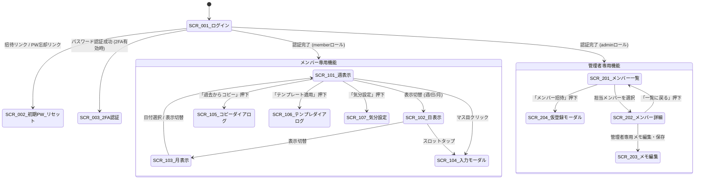
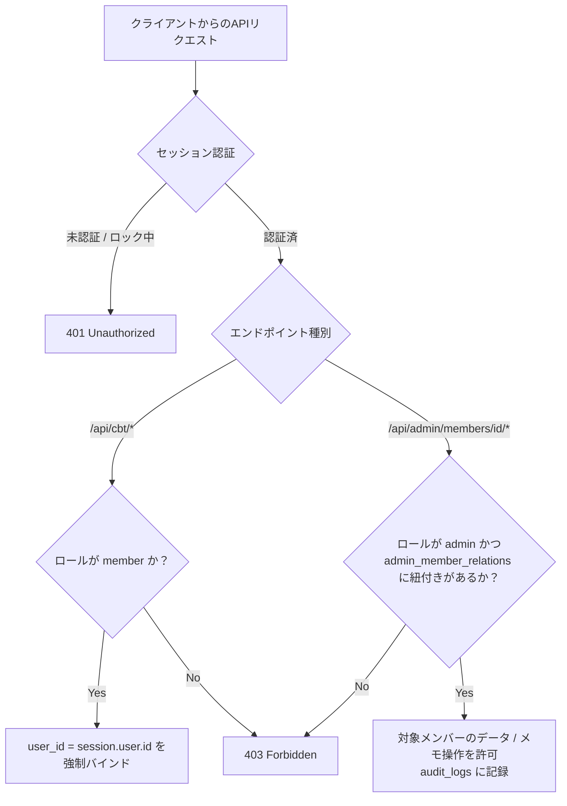
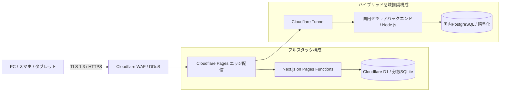

# CBT記録システム システム仕様書（基本設計・詳細設計）

- **文書バージョン**: 1.1.0
- **改定日**: 2026-10-16
- **対象システム**: CBT（認知行動療法）週間活動記録システム
- **関連文書**: `docs/requirements_specification.md`

---

## 1. システム全体アーキテクチャ・技術スタック

### 1.1 アーキテクチャ概要
本システムは、高いセキュリティとマルチデバイス（PC/タブレット/スマートフォン）での快適な操作性を両立するため、**TypeScript + Next.js (App Router)** をベースとしたWebアプリケーション構成を採用します。
運用の大前提として**「単一サーバー、単一インスタンス（Single Server / Single Instance）」**を採用し、外部Redis等の分散キャッシュや複雑なクラスタ基盤を排除して、Node.js ネイティブ環境＋SQLite 3 (WALモード)＋インメモリ制御によるゼロ依存・超軽量・高堅牢な自律稼働を実現します。

```mermaid
flowchart TD
    subgraph クライアント層 [マルチデバイス クライアント]
        PC[PC ブラウザ / 大画面]
        Tab[タブレット ブラウザ]
        SP[スマートフォン ブラウザ]
    end

    subgraph ネットワーク・エッジ層 [セキュリティ & ネットワーク]
        CDN[Cloud Armor WAF / TLS 1.3 終端]
    end

    subgraph アプリケーション層 [Next.js App Router (Node.js Runtime)]
        Router[Server Components / Route Handlers]
        AuthModule[認証・認可基盤 (auth-service.ts / mfa.ts)<br>(Argon2id + TOTP 2FA + token_version失効)]
        CBTModule[CBT記録コアエンジン<br>(日/週コピー, テンプレ展開, 気分正規化)]
        AdminModule[管理者支援モジュール<br>(担当管理, 秘匿メモ, 推移集計)]
        DAL[Data Access Layer (server-only)<br>(セッション強制バインド & DTOフィルタ)]
    end

    subgraph データ層 [データベース & ストレージ]
        DB[(SQLite 3 / PostgreSQL<br>AES-256 保存時暗号化)]
        BackupStorage[(暗号化バックアップストレージ)]
    end

    PC & Tab & SP -->|HTTPS / TLS 1.3| CDN
    CDN --> Router
    Router --> AuthModule & CBTModule & AdminModule
    AuthModule & CBTModule & AdminModule --> DAL
    DAL -->|Prisma ORM / SSL接続| DB
    DB -.->|日次スナップショット| BackupStorage
```

### 1.2 採用技術スタック
| レイヤー | 技術 / ツール | 選定理由・実装規約 |
| :--- | :--- | :--- |
| **フロントエンド** | Next.js 14+ (App Router), React 18+, TypeScript | サーバーコンポーネントによる初期描画高速化、型安全性。認証ルートは `force-dynamic` を強制。 |
| **UI・スタイリング** | Tailwind CSS, shadcn/ui, Lucide Icons | レスポンシブデザインの迅速な実装、アクセシビリティ対応、清潔で安心感のある医療系UI。 |
| **状態管理・データ取得** | TanStack Query (React Query) / SWR | クライアント状態の適切な管理（ログアウト時はクエリキャッシュを完全クリア）。 |
| **バックエンド** | Next.js Route Handlers / Server Actions, Zod | フロントとバックエンドの単一言語（TypeScript）統合、Zodによる厳格な入力スキーマ検証。 |
| **データアクセス・ORM** | Prisma ORM + Data Access Layer (`server-only`) | 型安全クエリ生成、SQLi防止。DAL層で `admin_memo` の構造的除外とテナント分離を強制。 |
| **データベース** | SQLite 3 (ローカル・Docker非依存) / PostgreSQL 16+ (クラウドマネージド) | 開発・単体運用時はDocker不要のSQLiteでゼロセットアップ稼働。Prisma ORMにより将来のCloud SQL等のマネージドDBへ透過的に互換。 |
| **認証・セキュリティ** | Node.js セキュア暗号基盤 (`crypto` + `@node-rs/argon2`) + 独自署名HttpOnly Cookie | Argon2idによるパスワードハッシュ、AES-256-GCM保存時暗号化、RFC 6238準拠TOTP、リプレイ防止（`last_totp_step`）、`token_version`による即時セッション失効。 |
| **エクスポート機能** | **完全非搭載（全廃）** | 最高水準の要配慮個人情報（メンタルヘルス情報）の端末残留やファイル持ち出し事故を防ぐため、Excel/CSV出力は一切提供しない。 |

---

## 2. 画面設計・UI/UX仕様

### 2.1 画面一覧（サイトマップ）

| 画面ID | 画面名 | 対象ロール | 主な機能・役割 |
| :--- | :--- | :--- | :--- |
| **SCR-001** | ログイン画面 | 全員 | メールアドレス・パスワード入力、2FAコード（またはリカバリーコード）入力 |
| **SCR-002** | パスワード初期設定 / リセット画面 | 全員 | 管理者招待時の初回パスワード設定、パスワード忘却時の再設定 |
| **SCR-003** | 2FA設定・管理画面 | 全員 | QRコードスキャンによるTOTP登録、リカバリーコード（10組）表示・再発行 |
| **SCR-101** | **週間活動記録メイン画面（週表示）** | メンバー | 24時間×7日間（月〜日）のマトリクス表、スロット編集、週送りナビ |
| **SCR-102** | **日別活動記録画面（日表示/スマホ最適）** | メンバー | 1日24時間の縦型タイムライン、片手操作での気分・活動入力 |
| **SCR-103** | **月間カレンダー画面（月表示）** | メンバー | 記録完了日・日別平均気分のヒートマップ表示、特定日・週へのジャンプ |
| **SCR-104** | スロット入力モーダル / ボトムシート | メンバー | 活動名、気分選択（気分スキップ/クリア可）、補足メモ入力 |
| **SCR-105** | 日/週コピーダイアログ | メンバー | コピー元選択、反映条件（空枠のみ/上書き、活動のみ/気分込み）の選択と実行 |
| **SCR-106** | テンプレート管理・適用ダイアログ | メンバー | 定型パターン（平日出勤・在宅・休日・療養等）の選択・カスタム保存・一括適用 |
| **SCR-107** | 気分・感情名・段階数設定画面 | メンバー | 対象感情名（気分の良さ/楽しみ度等）、表現形式（5種）、段階数（3〜11段階）設定 |
| **SCR-201** | **管理者：担当メンバー一覧画面** | 管理者 | 担当メンバー一覧、最新記録日、支援ステータス、表示/非表示フィルタ |
| **SCR-202** | **管理者：メンバー詳細・カルテ閲覧画面** | 管理者 | 担当メンバーの週間活動記録閲覧、日別/週別の気分推移グラフ表示 |
| **SCR-203** | **管理者：支援メモ編集コンポーネント** | 管理者 | メンバーごとの支援メモ（本人非公開）の閲覧・更新、更新日時・記録者表示 |
| **SCR-204** | **管理者：メンバー新規仮登録モーダル** | 管理者 | 氏名・メールアドレス入力による招待・仮登録メール発行 |

### 2.2 画面遷移図



### 2.3 主要画面ワイヤーフレーム・UI設計

#### ① 週間活動記録メイン画面 (PC / タブレット横向き)
```
+---------------------------------------------------------------------------------------+
| [ロゴ] CBT活動記録システム    [< 前週]  2026年10月12日(月)〜10月18日(日)  [次週 >] [今週]  (田中 太郎) [🔐2FA] [ログアウト] |
+---------------------------------------------------------------------------------------+
| [表示切替: (週) | 日 | 月]   [⚡ テンプレート適用]  [📋 過去からコピー]  [⚙ 気分設定(天気:5段階/気分の良さ)] |
+---------------------------------------------------------------------------------------+
|  時間帯      |     月 (10/12)    |     火 (10/13)    |     水 (10/14)    |  ...  |     日 (10/18)    |
|              |   行動   |  気分  |   行動   |  気分  |   行動   |  気分  |  ...  |   行動   |  気分  |
+--------------+----------+--------+----------+--------+----------+--------+-------+----------+--------+
| 午前0〜1時   | 就寝     |   -    | 就寝     |   -    | 就寝     |   -    |  ...  | 就寝     |   -    |
| 午前6〜7時   | 起床散歩 | ☀️ 80% | 起床     | 🌧️ 25% | 起床     | ☁️ 50% |  ...  | 起床     | 🌤️ 75% |
| 午前7〜8時   | 朝食準備 | ☁️ 50% | 朝食     | ☁️ 50% | 朝食     | ☁️ 50% |  ...  | 朝食     | ☀️ 80% |
| ...          | ...      | ...    | ...      | ...    | ...      | ...    |  ...  | ...      | ...    |
+---------------------------------------------------------------------------------------------------------+
※原本Excel（SCBT_2_katsudokiroku.xls）に完全準拠し、行動欄と気分（％）欄を独立列として分離表示。
※行動・気分のどちらのセルをクリックしても同一の入力モーダルが開き、活動名・気分・メモをワンストップでまとめて登録・編集可能。
```

#### ② 日別タイムライン（日表示: SCR-102）及び月間ヒートマップ（月表示: SCR-103）
- **日別タイムライン（SCR-102）**: スマートフォン縦画面（または詳細確認時）に最適化された縦型24時間タイムライン。左右のナビゲーションボタン（◀/▶）や各種アクションは片手操作に適した 44px 以上の大型タップ領域を維持。
- **月間ヒートマップ（SCR-103）**: 選択中の週が属する年月（木曜日基準のISO-8601動的判定）のカレンダーを動的生成。各日の記録スロット数と日別平均気分スコアを色・記号・数値で可視化し、日付クリックで該当日の日別タイムラインへジャンプ可能。うるう年や年跨ぎ・月跨ぎの曜日配置にも完全動的対応。

#### ③ 「気持ち（気分）」の入力・選択コンポーネント仕様
ユーザー設定（`emotion_label`, `style_type`, `scale_steps`）に応じて入力ピッカーが切り替わります。すべてのスタイルは**「`0.00`（最も不調）〜 `1.00`（最も良好）」の単一ポジティブ極性**に正規化されます。睡眠時など気分評価を行わない場合は「気分を記録しない（`null`）」を選択可能です。

```
【入力ピッカーのバリエーション例 (5段階設定時)】
1. 顔マーク (face):
   [ 😭 最悪(0%) ]  [ 🙁 不調(25%) ]  [ 😐 普通(50%) ]  [ 🙂 良好(75%) ]  [ 😄 最高(100%) ]

2. パワプロ風マーク (pawapuro):
   [ 💀 絶不調(0%) ] [ ⬇️ 不調(25%) ] [ ➡️ 普通(50%) ]  [ ⬆️ 好調(75%) ]  [ 🔥 絶好調(100%) ]

3. 天気マーク (weather):
   [ ⛈️ 荒天(0%) ]  [ 🌧️ 雨(25%) ]   [ ☁️ 曇り(50%) ]  [ 🌤️ 晴れ(75%) ]  [ ☀️ 快晴(100%) ]

4. 調子矢印マーク (arrow ※その時点の調子の向き):
   [ ⬇️ 大幅悪(0%) ] [ ↘️ やや悪(25%) ] [ ➡️ 平行(50%) ] [ ↗️ やや良(75%) ] [ ⬆️ 大幅良(100%) ]

5. 数値パーセント (number: 3〜11段階):
   [ 0% ] [ 10% ] [ 20% ] ... [ 100% ]

※ 7段階・9段階・11段階設定時は、各ボタンにパーセント値（例: ☀️ 快晴 100%, ☀️ 快晴 90%）を併記し、隣接段階を明確に判別可能とする。
```

---

## 3. データモデル・データベース設計

### 3.1 ER図 (Entity-Relationship Diagram)

```mermaid
erDiagram
    users ||--o{ admin_member_relations : "担当・被担当"
    users ||--o| user_profiles : "所有"
    users ||--o| mood_configurations : "設定"
    users ||--o{ cbt_activities : "記録"
    users ||--o{ activity_templates : "所有"
    users ||--o{ audit_logs : "操作主体"

    users {
        uuid id PK "ユーザーID"
        varchar email UK "メールアドレス"
        varchar password_hash "ハッシュ化パスワード (Argon2id)"
        varchar role "ロール (admin / member / sysadmin)"
        varchar status "アカウント状態 (invited / active / suspended)"
        integer failed_login_attempts "連続ログイン失敗回数"
        timestamptz locked_until "アカウントロック解除日時"
        boolean mfa_enabled "2FA有効フラグ"
        varchar mfa_secret "暗号化されたTOTPシークレット (v1:iv:tag:data)"
        jsonb mfa_recovery_codes "SHA-256ハッシュ化リカバリーコード配列"
        bigint last_totp_step "最終成功TOTPタイムステップ (リプレイ防止)"
        varchar invite_token "初回登録用セキュアハッシュトークン"
        timestamptz invite_expires_at "招待トークン有効期限"
        varchar reset_token "PWリセット用セキュアハッシュトークン"
        timestamptz reset_expires_at "PWリセットトークン有効期限"
        timestamptz last_login_at "最終ログイン日時"
        timestamptz created_at "作成日時"
        timestamptz updated_at "更新日時"
    }

    user_profiles {
        uuid user_id PK, FK "ユーザーID"
        varchar display_name "表示名 / 氏名"
        text note "プロフィール補足"
        timestamptz updated_at "更新日時"
    }

    admin_member_relations {
        uuid id PK "関連ID"
        uuid admin_id FK "管理者ユーザーID"
        uuid member_id FK "メンバーユーザーID"
        varchar support_status "支援状態 (active / paused / completed)"
        boolean is_visible "管理者側の一覧表示/非表示フラグ"
        text admin_memo "管理者専用支援メモ (メンバー本人には絶対非公開)"
        uuid memo_updated_by FK "メモ最終更新管理者ID"
        timestamptz memo_updated_at "メモ最終更新日時"
        timestamptz created_at "作成日時"
    }

    mood_configurations {
        uuid id PK "設定ID"
        uuid user_id UK, FK "ユーザーID"
        varchar emotion_label "記録対象の感情名 (例: 気分の良さ, 楽しみ度, 達成感)"
        varchar style_type "表現形式 (number / face / pawapuro / weather / arrow)"
        smallint scale_steps "段階数 (3 〜 11)"
        jsonb custom_labels "段階ごとのラベル・絵文字定義JSON"
        timestamptz updated_at "更新日時"
    }

    cbt_activities {
        uuid id PK "活動記録ID"
        uuid user_id FK "メンバーユーザーID"
        date record_date "対象日 (YYYY-MM-DD)"
        smallint hour_slot "時間枠 (0 〜 23)"
        varchar activity_name "活動内容 (例: 起床, 朝食, 散歩, 就寝)"
        real mood_score "正規化気分スコア (0.00 〜 1.00 / 未入力・睡眠時はNULL)"
        smallint mood_raw_level "入力時の選択段階レベル (0 〜 scale_steps-1 / NULL)"
        varchar mood_display_symbol "入力時のアイコンスナップショット (例: ☀️, 😄 / NULL)"
        text notes "補足・気付きメモ"
        timestamptz created_at "作成日時"
        timestamptz updated_at "更新日時"
    }

    activity_templates {
        uuid id PK "テンプレートID"
        uuid user_id FK "所有ユーザーID (NULL時はシステム共通プリセット)"
        varchar template_name "テンプレート名 (例: 平日出勤パターン)"
        varchar template_type "種類 (day: 1日分 / week: 1週間分)"
        jsonb schedule_data "スロット定義JSON (活動予定のみ保持)"
        timestamptz created_at "作成日時"
        timestamptz updated_at "更新日時"
    }

    audit_logs {
        uuid id PK "ログID"
        uuid actor_id FK "操作者ユーザーID"
        uuid target_user_id "対象メンバーID (該当する場合)"
        varchar action "実行アクション (LOGIN, VIEW_MEMBER, UPDATE_MEMO, APPLY_TEMPLATE等)"
        varchar ip_address "クライアントIP"
        varchar user_agent "クライアントUA"
        jsonb details "操作メタデータ (※機微テキスト本文は含めない)"
        timestamptz created_at "記録日時"
    }
```



### 3.2 テーブル定義詳細

#### ① `users`（ユーザー認証テーブル）
| カラム名 | 型 | NULL | デフォルト | 説明 |
| :--- | :--- | :---: | :---: | :--- |
| `id` | UUID | NO | `gen_random_uuid()` | 主キー |
| `email` | VARCHAR(255) | NO | - | メールアドレス（ユニークインデックス、小文字正規化） |
| `password_hash` | VARCHAR(255) | YES | - | Argon2idハッシュ文字列（仮登録時はNULL） |
| `role` | VARCHAR(32) | NO | `'member'` | `'admin'`（管理者）, `'member'`（メンバー）, `'sysadmin'`（システム管理者） |
| `status` | VARCHAR(32) | NO | `'invited'` | `'invited'`（仮登録）, `'active'`（有効）, `'suspended'`（停止） |
| `failed_login_attempts` | INTEGER | NO | `0` | 連続ログイン失敗回数（ログイン成功時に0へリセット） |
| `locked_until` | TIMESTAMPTZ | YES | - | アカウントロック解除日時（5回失敗時に `NOW() + 15分` をセット） |
| `mfa_enabled` | BOOLEAN | NO | `false` | 2要素認証の有効状態 |
| `mfa_secret` | VARCHAR(255) | YES | - | `AES-256-GCM` 暗号化されたTOTPシークレット（`v1:iv:authTag:encrypted`） |
| `mfa_recovery_codes` | JSONB | YES | - | SHA-256ハッシュ化された未使用リカバリーコードの配列 |
| `last_totp_step` | BIGINT | YES | - | 最後に認証成功したTOTPタイムステップ（同一ステップ以下の再利用を拒否） |
| `token_version` | INTEGER | NO | `0` | セッションバージョン（ログアウト・PW変更時にインクリメントして即時失効） |
| `reset_token` | VARCHAR(255) | YES | - | 初回招待・パスワード設定・リセット用トークンのSHA-256ハッシュ |
| `reset_expires_at` | TIMESTAMPTZ | YES | - | トークン有効期限（招待発行から48時間） |
| `created_at` | TIMESTAMPTZ | NO | `NOW()` | 作成日時 |
| `updated_at` | TIMESTAMPTZ | NO | `NOW()` | 更新日時 |

#### ② `admin_member_relations`（担当・管理者メモテーブル）
`admin_id` + `member_id` に複合ユニーク制約 `UNIQUE(admin_id, member_id)` を付与します。
| カラム名 | 型 | NULL | デフォルト | 説明 |
| :--- | :--- | :---: | :---: | :--- |
| `id` | UUID | NO | `gen_random_uuid()` | 主キー |
| `admin_id` | UUID | NO | - | 担当管理者のユーザーID（FK: `users.id`） |
| `member_id` | UUID | NO | - | 対象メンバーのユーザーID（FK: `users.id`） |
| `support_status` | VARCHAR(32) | NO | `'active'` | 支援進行状態：`'active'`（進行中）, `'paused'`（休止）, `'completed'`（完了） |
| `is_visible` | BOOLEAN | NO | `true` | 管理者一覧での表示/非表示フラグ（非表示時はアーカイブ扱い） |
| `admin_memo` | TEXT | NO | `''` | **管理者専用支援メモ（メンバー側には一切返却されない）** |
| `memo_updated_by` | UUID | YES | - | メモ最終更新者の管理者ID（FK: `users.id`） |
| `memo_updated_at` | TIMESTAMPTZ | YES | - | メモ最終更新日時 |
| `created_at` | TIMESTAMPTZ | NO | `NOW()` | 担当紐付け作成日時 |

#### ③ `cbt_activities`（CBTスロット記録テーブル）
`user_id` + `record_date` + `hour_slot` に複合ユニーク制約 `UNIQUE(user_id, record_date, hour_slot)` を付与します。
| カラム名 | 型 | NULL | デフォルト | 説明 |
| :--- | :--- | :---: | :---: | :--- |
| `id` | UUID | NO | `gen_random_uuid()` | 主キー |
| `user_id` | UUID | NO | - | メンバーID（FK: `users.id`） |
| `record_date` | DATE | NO | - | 記録対象年月日（`YYYY-MM-DD`。アプリ層ではUTC境界固定文字列として扱う） |
| `hour_slot` | SMALLINT | NO | - | 時間枠（0〜23。0: 午前0〜1時、12: 正午〜1時、23: 午後11〜0時） |
| `activity_name` | VARCHAR(255) | NO | `''` | 活動内容テキスト |
| `mood_score` | REAL | YES | `NULL` | **正本正規化スコア（`0.00`〜`1.00`。未入力・睡眠時は必ず `NULL`）** |
| `mood_raw_level` | SMALLINT | YES | `NULL` | 入力時点の選択段階インデックス（`0` 〜 `scale_steps - 1`） |
| `mood_display_symbol`| VARCHAR(32) | YES | `NULL` | 入力時点の表示記号スナップショット（例: `☀️`, `😄`, `⬆️`） |
| `notes` | TEXT | YES | - | 補足・気付きメモ |
| `created_at` | TIMESTAMPTZ | NO | `NOW()` | 登録日時 |
| `updated_at` | TIMESTAMPTZ | NO | `NOW()` | 更新日時 |

#### ④ `mood_configurations`（気持ち・表現設定テーブル）
| カラム名 | 型 | NULL | デフォルト | 説明 |
| :--- | :--- | :---: | :---: | :--- |
| `id` | UUID | NO | `gen_random_uuid()` | 主キー |
| `user_id` | UUID | NO | - | 設定所有ユーザーID（ユニーク、FK: `users.id`） |
| `emotion_label` | VARCHAR(64) | NO | `'気分の良さ'` | 記録対象の感情名（例: `'気分の良さ'`, `'楽しみ度'`, `'達成感'`, `'充実度'`） |
| `style_type` | VARCHAR(32) | NO | `'weather'` | `'number'`, `'face'`, `'pawapuro'`, `'weather'`, `'arrow'` |
| `scale_steps` | SMALLINT | NO | `5` | 段階数（`3` 〜 `11`） |
| `custom_labels` | JSONB | NO | `'[]'` | 各段階の定義（スコア、アイコン、ラベル） |
| `updated_at` | TIMESTAMPTZ | NO | `NOW()` | 更新日時 |

---

## 4. API設計（エンドポイント仕様）

IDOR（水平権限昇格）を構造的に防止するため、**メンバー自身のデータを操作する `/api/cbt/*`（`session.user.id` 強制バインド）**と、**管理者が担当メンバーのデータを参照する `/api/admin/members/[id]/*`（担当関係検証強制）**を明確に分離します。

### 4.1 認証・初期設定系 API
| メソッド | エンドポイント | 説明 | 認証 | ロール |
| :--- | :--- | :--- | :---: | :---: |
| `POST` | `/api/auth/login` | メール・PW検証、ロックアウト判定、2FA要求判定 | 不要 | 全員 |
| `POST` | `/api/auth/mfa/verify` | TOTPコードまたはリカバリーコード検証＆セッション発行 | 一時トークン | 全員 |
| `POST` | `/api/auth/setup-password` | 初回招待トークンによる本登録・パスワード設定 | 不要 (Token) | `member` |
| `POST` | `/api/auth/forgot-password` | パスワードリセット案内メール送信要求 | 不要 | 全員 |
| `POST` | `/api/auth/reset-password` | リセットトークン検証＆新パスワード設定 | 不要 (Token) | 全員 |
| `POST` | `/api/auth/logout` | セッション破棄・Cookie削除 | 必須 | 全員 |
| `POST` | `/api/user/mfa/generate` | 2FA有効化用QRコード・暗号化シークレット発行 | 必須 | 全員 |
| `POST` | `/api/user/mfa/enable` | 2FA有効化の確定（TOTP突合＆リカバリーコード10組発行） | 必須 | 全員 |

### 4.2 管理者専用 API（担当関係チェック強制）
| メソッド | エンドポイント | 説明 | 認証 | ロール |
| :--- | :--- | :--- | :---: | :---: |
| `GET` | `/api/admin/members` | 担当メンバー一覧取得（表示/非表示・支援状態フィルタ対応） | 必須 | `admin` |
| `POST` | `/api/admin/members/invite`| メンバー仮登録および招待メール発行 | 必須 | `admin` |
| `PATCH` | `/api/admin/members/[id]/visibility` | 担当メンバーの表示/非表示・支援ステータス切り替え | 必須 | `admin` |
| `GET` | `/api/admin/members/[id]/memo` | 管理者専用メモ取得（メンバー本人には非公開） | 必須 | `admin` |
| `PUT` | `/api/admin/members/[id]/memo` | 管理者専用メモ更新（`memo_updated_by` 自動記録） | 必須 | `admin` |
| `GET` | `/api/admin/members/[id]/activities/week` | 担当メンバーの指定週記録＆気分推移サマリー取得 | 必須 | `admin` |

### 4.3 メンバー専用 CBT記録・操作系 API（`session.user.id` 強制バインド）
| メソッド | エンドポイント | 説明 | 認証 | ロール |
| :--- | :--- | :--- | :---: | :---: |
| `GET` | `/api/cbt/activities/week?monday=YYYY-MM-DD` | 自身の1週間分（7日×24時間）の記録一括取得 | 必須 | `member` |
| `GET` | `/api/cbt/activities/month?year_month=YYYY-MM` | 自身の月間サマリー（日別記録数・平均気分スコア）取得 | 必須 | `member` |
| `PUT` | `/api/cbt/activities/slot` | 特定1スロットの登録・更新（`mood_score: null` 対応） | 必須 | `member` |
| `POST` | `/api/cbt/activities/range` | **複数スロット（時間帯範囲・就寝一括）の連続登録** | 必須 | `member` |
| `DELETE` | `/api/cbt/activities/slot` | 特定1スロットの記録クリア | 必須 | `member` |
| `POST` | `/api/cbt/copy/day` | **過去日の丸ごとコピー実行** | 必須 | `member` |
| `POST` | `/api/cbt/copy/week` | **過去週の丸ごとコピー実行** | 必須 | `member` |
| `POST` | `/api/cbt/templates/apply` | **テンプレートの一括適用実行（活動予定のみ反映）** | 必須 | `member` |
| `GET` | `/api/cbt/templates` | 利用可能なテンプレート一覧取得（プリセット＋個人保存） | 必須 | `member` |
| `POST` | `/api/cbt/templates` | 現在の1日/1週の活動予定をカスタムテンプレートとして保存 | 必須 | `member` |
| `GET` | `/api/cbt/mood-config` | 自身の気分表現設定取得 | 必須 | `member` |
| `PUT` | `/api/cbt/mood-config` | 自身の気分表現設定（感情名・スタイル・段階数）更新 | 必須 | `member` |

### 4.4 リクエスト / レスポンス詳細例

#### 例1: 過去日の丸ごとコピー (`POST /api/cbt/copy/day`)
- **リクエスト**:
```json
{
  "sourceDateYmd": "2026-10-13",
  "targetDateYmd": "2026-10-15",
  "overwriteNonEmpty": false,
  "includeMood": false
}
```
- **レスポンス (200 OK)**:
```json
{
  "copiedCount": 15
}
```

#### 例2: スロット更新 (`PUT /api/cbt/activities/slot`)
- **リクエスト**（気分選択ありの場合 / 睡眠等で気分未記録の場合は `"moodScore": null, "moodRawLevel": null, "moodDisplaySymbol": null`）:
```json
{
  "recordDateYmd": "2026-10-15",
  "hourSlot": 14,
  "activityName": "散歩とカフェ",
  "moodScore": 0.75,
  "moodRawLevel": 3,
  "moodDisplaySymbol": "🌤️",
  "notes": "日差しが暖かく気分がすっきりした"
}
```
- **レスポンス (200 OK)**（※クライアントが設定に基づいて算出した `moodScore`, `moodRawLevel`, `moodDisplaySymbol` を検証・アトミック保存し `ActivitySlotDTO` を返却）:
```json
{
  "id": "a5d89f82-3d84-4bf8-bf4a-d68a2bc1e091",
  "hourSlot": 14,
  "activityName": "散歩とカフェ",
  "moodRawLevel": 3,
  "moodScore": 0.75,
  "moodDisplaySymbol": "🌤️",
  "notes": "日差しが暖かく気分がすっきりした"
}
```

#### 例3: 複数スロット・睡眠範囲一括登録・更新 (`POST /api/cbt/activities/range`)
- **リクエスト**（木曜23時〜金曜7時の睡眠一括登録、日跨ぎ8時間、睡眠時は気分 `null`、または登録済み同一活動ブロックの一括更新）:
```json
{
  "startDateYmd": "2026-10-15",
  "startHourSlot": 23,
  "durationHours": 8,
  "activityName": "就寝",
  "moodScore": null,
  "moodRawLevel": null,
  "moodDisplaySymbol": null,
  "notes": null,
  "overwriteNonEmpty": false,
  "allowFirstSlotOverwrite": true,
  "originalActivityName": "就寝"
}
```
> ※ `originalActivityName` を指定するか、または開始スロットの活動名と同一の後続スロットは同一活動ブロックの更新とみなされ、`overwriteNonEmpty: false` であってもスキップ保護されずに一括適用されます（他活動の誤上書き防止と一括再編集のスムーズな両立）。
- **レスポンス (200 OK)**:
```json
{
  "success": true,
  "appliedCount": 8,
  "affectedDates": ["2026-10-15", "2026-10-16"]
}
```

---

## 5. セキュリティ詳細仕様

### 5.1 認証認可 & データ分離ガード
本システムでは、要配慮個人情報を取り扱うため、**ロールベースアクセス制御（RBAC）** に加え、リレーションレベルでのアクセス制御を Data Access Layer (`server-only`) で強制します。



- **管理者メモ（`admin_memo`）の完全不可視化**:
  - `admin_memo` フィールドは `/api/admin/members/[id]/memo` 以外のシリアライザでは `select` 句から構造的に除外され、メンバー画面からは通信ペイロード上も一切閲覧できません。

### 5.2 2段階認証 (TOTP) 実装仕様
- RFC 6238準拠。アルゴリズム: SHA-1, 桁数: 6桁, 有効周期: 30秒。
- クロックドリフト（端末時刻の軽微なズレ）を考慮し、前後±1ステップ（計90秒間）の許容マージンを実装。
- **リプレイ攻撃防止**: 認証成功時のタイムステップ整数値を `users.last_totp_step` に記録し、`current_step <= last_totp_step` のコードは許容時間内であっても拒否します。
- 2FA設定完了時に8桁の英数字リカバリーコードを10組生成し、DB（`mfa_recovery_codes`）にはSHA-256ハッシュで保存します（使用されたコードは配列から削除）。

### 5.3 暗号化方針
1. **通信路暗号化**:
   - 常時TLS 1.3強制。HSTS有効化。
2. **保存時暗号化 (Encryption-at-Rest)**:
   - データベースボリューム全体のAES-256暗号化。
   - 2FA秘密鍵（`mfa_secret`）は、アプリケーション側で環境変数マスターキーによる `AES-256-GCM` 暗号化を実施し、将来の鍵ローテーションに対応する `v1:iv:authTag:encryptedData`（Hex形式）でDBに格納します。

### 5.4 攻撃防御・監査ログ保護仕様
1. **多層CSRF防御（Fetch Metadata & Same-Origin）**:
   - モダンブラウザが強制付与する Fetch Metadata（`Sec-Fetch-Site: cross-site`）を検出した場合、即座に 403 Forbidden で先制遮断。
   - `Origin` / `Referer` ヘッダーと `Host` ヘッダーの完全一致を検証し、外部オリジンからの状態変更（POST/PUT/PATCH/DELETE）を確実に防止。
2. **多層レートリミッター（スライディングウィンドウ）**:
   - 認証エンドポイント（`/api/auth/login`, `/api/auth/setup-password`）および管理者招待（`/api/admin/members/invite`）に対し、IP単位およびアカウント単位の二重スライディングウィンドウ制限（`checkRateLimit`）を適用。
   - 単一サーバー運用に最適化されたインメモリLRU機構（最大10,000エントリ、5分定期消去）により、DoS攻撃およびリソース枯渇を防止。
3. **監査ログにおける機微情報（PII/PHI）完全排除**:
   - 監査証跡（`audit_logs`）には操作メタデータ（`actor_id`, `target_user_id`, `action`, `ip_address`, `created_at`）のみを記録。
   - 平文メールアドレス、パスワード、認証コード、活動内容、支援メモ本文等の要配慮個人情報・PIIは `details` から完全に除外・マスキング。

---

## 6. デプロイ・インフラ設計

### 6.1 推奨構成: Google Cloud 構成（マネージド・高セキュリティ）

```mermaid
flowchart LR
    User[PC / スマホ / タブレット] -->|HTTPS 443| Armor[Google Cloud Armor (WAF / DDoS)]
    Armor --> LB[Cloud Load Balancing]
    LB --> Run[Cloud Run<br>(Next.js App コンテナ)]
    Run -->|Cloud SQL Auth Proxy (TLS)| SQL[(Cloud SQL for PostgreSQL<br>東京リージョン / 暗号化)]
    Run -->|API| Mail[メール配信サービス (招待/PWリセット)]
    SQL -.->|自動スナップショット| GCS[(Cloud Storage<br>暗号化バックアップ)]
```

- **インフラ構成要素**:
  - **フロント・バックエンド**: Cloud Run（コンテナ実行、日中帯のコールドスタート対策として必要に応じて最小インスタンスを設定）。
  - **データベース**: Cloud SQL for PostgreSQL（高可用性構成、自動日次バックアップ、東京リージョン固定）。
  - **シークレット管理**: Secret Manager（環境変数、DB接続パスワード、暗号鍵の秘匿管理）。
  - **CI/CD**: GitHub Actions から Workload Identity 連携により、長期認証キーを持たずに安全にコンテナビルド・デプロイを実施。

### 6.2 代替構成 A: 自ホスト非公開構成（オンプレ / 完全閉域VPN・Docker非使用ネイティブ）
完全非公開での運用を希望する場合の設計です。Docker完全非使用でNode.jsネイティブ稼働します。

```mermaid
flowchart LR
    RemoteMember[メンバー端末 (自宅/外出先)] -->|Tailscale / Cloudflare Zero Trust| Tunnel[安全な閉域トンネル]
    Tunnel --> HostNode[ローカルホスト / Node.js native]
    subgraph HostNode [Node.js ネイティブ閉域環境 (Docker完全非使用)]
        App[Next.js App (node server)]
        DB[(PostgreSQL / SQLite WALモード / 暗号化)]
        Cron[日次バックアップCronスクリプト]
    end
    App --> DB
    DB -.-> Cron
```

### 6.3 代替構成 B: Cloudflare Pages 構成（エッジ配信・フルサーバーレス / ハイブリッド閉域）
世界300都市以上のCloudflareエッジネットワークを活用した超高速・高セキュリティな配信構成です。詳細な設定手順は `docs/cloudflare_pages_guide.md` を参照してください。



- **インフラ構成要素**:
  - **フロントエンド / SSR**: Cloudflare Pages (`@cloudflare/next-on-pages` / `wrangler.toml` 完備)。
  - **エッジ互換性**: `src/lib/auth-service.ts` による WebCrypto / PBKDF2 耐障害性レイヤー完備。
  - **セキュリティ**: 全APIレスポンスの `Cache-Control: no-store` 強制により、CDNエッジへの要配慮個人情報キャッシュ混入を完全遮断。
  - **閉域連携**: Cloudflare Tunnel（`cloudflared`）または Cloudflare Zero Trust と連携することで、患者・メンバーの生データをエッジ外のセキュア環境に完全隔離可能。

---

## 7. 開発ロードマップ（`development_plan.md` 準拠）

1. **Phase 1（MVP基盤・コアセキュリティ開発）**:
   - DBスキーマ・マイグレーション構築、Data Access Layer (`server-only`)・監査ログ基盤（`audit_logs`）の実装
   - 認証基盤（メール/PW認証、アカウントロックアウト、仮登録〜本登録フロー、パスワードリセット）
   - 週間活動記録シートの週表示・日表示・月表示（ヒートマップ）UI、1時間ごとの活動＆気分入力（`mood_configurations` 基本連携、未入力 `null` 制御）
   - 管理者による担当メンバー一覧、シート閲覧、および**管理者専用メモ（メンバー非公開ガード込み）**の実装
2. **Phase 2（入力効率化・伴走強化・2FA）**:
   - 過去日の丸ごとコピー、過去週の丸ごとコピー機能（空枠のみ反映・気分コピー有無選択対応）
   - ルーティン・テンプレート作成および一括適用機能
   - 管理者画面での気分推移グラフ・サマリー表示、表示/非表示アーカイブ整理機能
   - 2段階認証（TOTP + リカバリーコード + リプレイ防止）オプトイン機能
3. **Phase 3（セキュリティ・非機能強化・本番リリース）**:
   - セキュリティヘッダー（CSP, HSTS, `Cache-Control: no-store`等）、レートリミット強化、ペネトレーション・権限分離テスト
   - 本番インフラ構築、CI/CDパイプライン整備、バックアップ/リストア検証、本番運用開始
4. **Phase 4（運用開始後の継続改善）**:
   - 実運用フィードバックに基づくUI微調整、PWA対応拡張